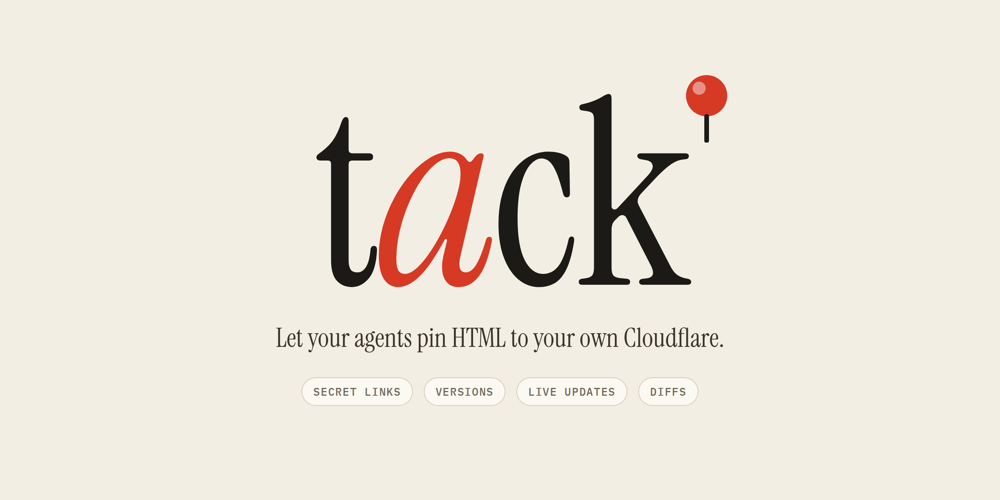

An agent runs `tack upload plan.html` and replies with a link. Uploading again adds a version under the same link, and open tabs update live.

- **Secret links.** Anyone with a link can read it; nobody can guess one.
- **Versions.** `/id` is the latest, `/id/v/2` is pinned, plus `/_history` and `/_diff`.
- **Anything goes.** Served byte-for-byte: scripts, assets, multi-page folders.
- **Free plan friendly.** One Worker, one R2 bucket, one Durable Object.

## Setup

1. Create an R2 bucket named `tack`.
2. Workers & Pages → Import this repo. Deploy command `bunx wrangler deploy`, build variable `BUN_VERSION=1.4.0`. If you fork it, put your domains in `wrangler.jsonc` (`routes` and `vars`: docs on one host, the doc list on another), `DEFAULT_URL` in `cli/tack.ts` and `base` in `cli/install.sh`.
3. Install the CLI and skill (running from the repo needs Node 22.18+):

```sh
bun install
mkdir -p ~/.local/bin ~/.agents/skills
ln -s "$PWD/cli/tack.ts" ~/.local/bin/tack
ln -s "$PWD/skill/tack" ~/.agents/skills/tack
tack setup   # creates a token and sets it on the Worker
tack open    # unlocks the doc list (list.tack.rex.wf) in your browser
```

Any other machine with Node 20+ installs the CLI and skill from your instance:

```sh
curl -fsSL https://tack.rex.wf/install | sh
tack setup --token   # paste the token from ~/.config/tack/config.json on the first machine
```

## CLI

```
tack upload <file|dir|-> [--new] [--slug s] [--note n] [--json]
tack get <slug|url> [--v n]
tack list [--match words] [--json]
tack open [slug]
tack rm <slug> [--v n]
tack mv <slug> <new-slug>
tack setup [--token | --rotate]
tack update
```

## Dev

```sh
printf 'TACK_TOKEN=dev\nDOCS_HOST=127.0.0.1:8787\nLIST_HOST=list.localhost:8787\n' > .dev.vars
bun run dev
TACK_URL=http://127.0.0.1:8787 TACK_TOKEN=dev tack upload plan.html
```

Internals and invariants are in [AGENTS.md](AGENTS.md).
